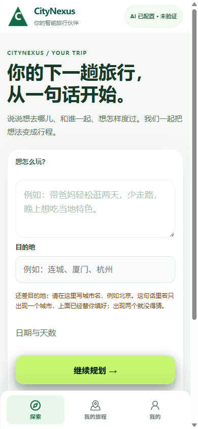
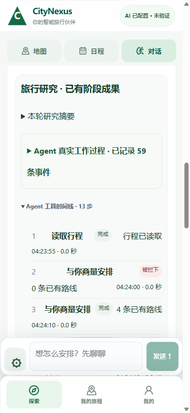
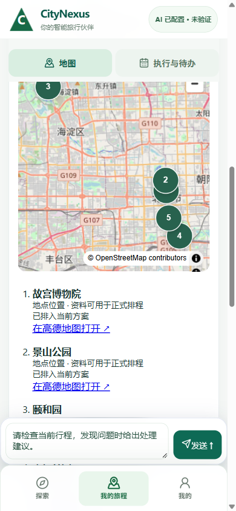
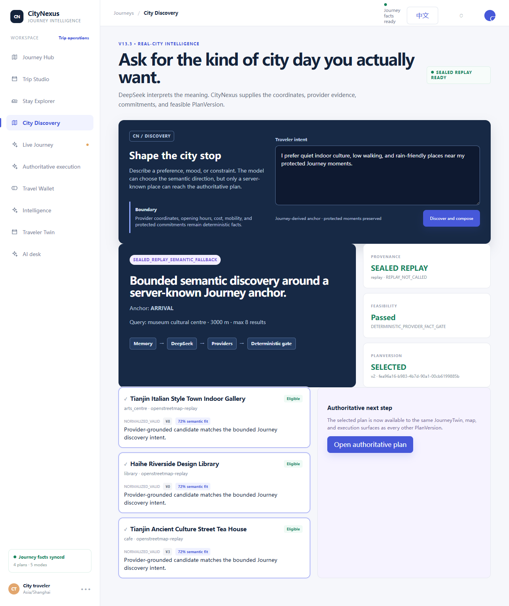
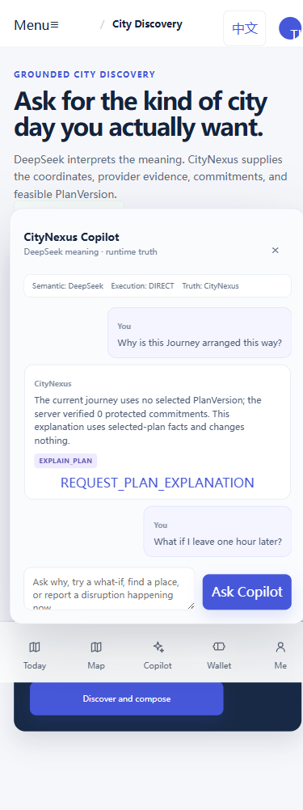
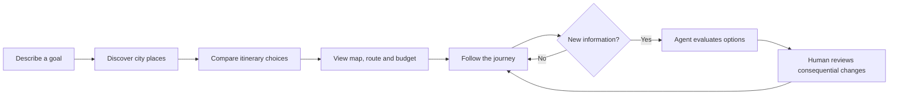
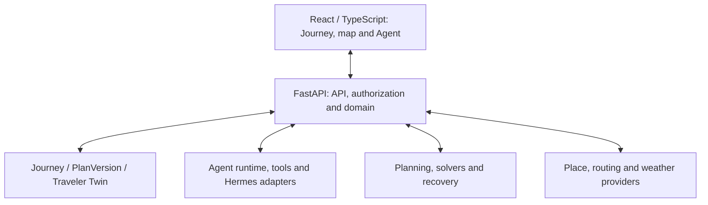

# CityNexus
### From "plan my day" to "keep my journey going"

**Smart City Traveler System | Software Engineering coursework | September–November 2026**

**React + TypeScript · Python + FastAPI · AI Agent + Hermes tools · Maps / routes / weather · Visio + Microsoft Project**

CityNexus is an engineering project exploring an agent-assisted city journey system. Its purpose is to go beyond one-off attraction recommendations: learn the traveller's goal, discover grounded places, construct and compare an itinerary, make the journey visible, and manage changes with appropriate human authorization.

**This is an implementation and coursework portfolio, not just a concept proposal.** It contains extensive source code, API and domain models, automated tests, agent experiments, diagrams, and project planning artifacts.

## The fastest way to see the project

**[120-second illustrated teacher walkthrough](docs/DEMO_STORYBOARD.md)** · **[What was actually verified? Evidence matrix](docs/FEATURE_VERIFICATION_MATRIX.md)** · **[English screenshot-based website (deployment instructions)](docs/SITE_DEPLOYMENT.md)**

The new website files include a **nine-stage interactive visual tour** built from original development screenshots. It is not a live connected App; GitHub Pages must be enabled before its public website URL can be used. Meanwhile, the Markdown walkthrough above opens immediately on GitHub.

## Complete project portal: five public repositories, three development tracks

**[OPEN THE COMPLETE CITYNEXUS PROJECT PORTAL](docs/PROJECT_PORTAL.md)** · [English reviewer walkthrough](docs/START_HERE_FOR_REVIEWER.md) · [Chinese overview / 中文导航](README.zh-CN.md)

The project progressed through **(1) full-stack travel application and Software Engineering foundations, (2) Codex Revolution Lab autonomous Agent research, and (3) Qoder-led human-first Revolution V3 and classroom simulation**. These tracks share a goal, but should not be mistaken for one fully merged, production-validated release.

| Where to begin | What the reviewer will actually find |
| --- | --- |
| **[Project master overview](docs/PROJECT_PORTAL.md)** | What the product is, major achievements, agent capabilities and one coherent guided tour |
| **[Latest human-first V3 evidence](docs/CLASSROOM_AND_V3.md)** | **October 2026** real Chrome mobile captures, map, Agent tool progress, classroom time/location simulation and measured boundaries |
| **[Real research cases](docs/EXPERIMENT_RESULTS.md)** | External Agent actions, source-grounded routes, group recovery, two-stop city walks; real provider vs fixture clearly distinguished |
| **[Development provenance](docs/DEVELOPMENT_STREAMS.md)** | Where the original Qoder/Codex code branches, reports, Git commits and archived work live |
| **[Coursework evidence](teacher-materials/README.md)** | Requirements, Visio, architecture/user flow, Gantt, WBS and editable Microsoft Project |

### Newer V3 work: natural-language travel, visible Agent activity and a real map

| Human-first goal entry | Agent activity / tool timeline | Map with source-linked plan places |
| --- | --- | --- |
|  |  |  |

These are **authentic October development/test captures**, not artificially generated preview screens. The V3 research branch was updated as recently as **29 October 2026**. The **original CityNexus default branch is older (September 26)**, so do not treat the default branch as the project's latest UI.

**[See what happened in the five-minute classroom simulation](docs/CLASSROOM_AND_V3.md)** · [Open original V3 implementation](https://github.com/Canshu-King/CityNexus/tree/rescue/v3-final-departure-20261022)

### Original source repositories, now all public

| Repository | Role |
| --- | --- |
| [**CityNexus**](https://github.com/Canshu-King/CityNexus) | Full original code and history, including [Revolution Lab](https://github.com/Canshu-King/CityNexus/tree/gpt/revolution-r33-open-world-journey-adaptation), [human-first V3](https://github.com/Canshu-King/CityNexus/tree/rescue/v3-final-departure-20261022) and [Nov 4 coursework branch](https://github.com/Canshu-King/CityNexus/tree/coursework/part2-20261104-kickoff) |
| [**CityNexus-Workspace**](https://github.com/Canshu-King/CityNexus-Workspace) | Early research, project handoffs, original assignment brief and academic workspace |
| [**CityNexus-Lab-Archive**](https://github.com/Canshu-King/CityNexus-Lab-Archive) | Historical WorkBuddy, DSH, agent-experience and testing archives |
| [**CityNexus-History**](https://github.com/Canshu-King/CityNexus-History) | Early V14/V15 implementation/release staging and snapshots |
| [**This coursework portal**](https://github.com/Canshu-King/CityNexus-Coursework-2026) | Teacher-facing explanation, sanitized representative source, pictures and engineering documents |

## See the actual application screens

These are **real captured CityNexus development/test screenshots**, not newly invented mockups. Some display controlled replay data.

| City discovery and grounded candidates | Agent conversation on a phone |
| --- | --- |
|  |  |

**[View the full illustrated gallery: maps, journey, mobility, recovery, trip export, diagrams and Gantt](docs/VISUAL_GALLERY.md)**

## For the professor: see the real work in minutes

| Time | What to inspect | Open |
| --- | --- | --- |
| **2 min** | Actual captured UI screens, Agent and city discovery | **[Visual Gallery](docs/VISUAL_GALLERY.md)** |
| **2 min** | The user experience, the Agent, and the end-to-end *design* | **[Guided Product Tour](docs/START_HERE_FOR_REVIEWER.md)** |
| **3 min** | Actual features with direct links to frontend, backend and test files | **[Feature Atlas](docs/FEATURE_ATLAS.md)** |
| **3 min** | Ten concrete lab studies, including a real walking route, model-driven strategy and mobile tests | **[Experimental Results](docs/EXPERIMENT_RESULTS.md)** |
| **2 min** | Visio architecture, user–Agent flow, Gantt chart and WBS | **[Teacher Materials](teacher-materials/README.md)** |
| **2 min** | How the project evolved over three calendar months | **[Development Timeline](docs/DEVELOPMENT_TIMELINE.md)** |

## What is the product supposed to do?

A traveller asks: **"Plan a relaxed cultural trip. Avoid too much walking, and help if the day changes."** The product was designed around this continuing interaction:

These steps describe the **intended connected product journey** and corresponding implementation modules, not a fresh claim that the complete flow passed a production-grade live demo.

## A substantial implementation, not a handful of mockups

| Product area | What the source contains | Evidence |
| --- | --- | --- |
| **Traveller experience** | Journey setup, preferences, itinerary, spending, hotels and checklists | [Main UI](frontend/src/app/V8Experience.tsx) · [Trip screens](frontend/src/features/trip/) |
| **Maps and places** | Map panels, venue discovery, provider attribution, routing and contextual weather | [Map](frontend/src/components/JourneyMap.tsx) · [Discovery](frontend/src/features/discovery/) · [Integrations](backend/app/integrations/) |
| **AI Agent** | Conversation, what-if intents, missions, tool calls, runtime status, approval and Guardian signals | [Agent UI](frontend/src/features/agent/) · [Agent runtime](backend/app/agent/) · [MCP tools](agent-mcp/) |
| **Planning engine** | Candidate plans, comparisons, optimisation adapters and preserved commitments | [Planning UI](frontend/src/features/planning/) · [Planning engine](backend/app/planning/) |
| **Adaptation** | Live journey execution, disruption and recovery, replanning and plan-version history | [Execution](frontend/src/features/execution/) · [Replanning](backend/app/replanning/) |
| **Shared journeys** | Sharing, private member states and group-recovery research | [Shared UI](frontend/src/features/shared/) · [Revolution Lab](experiments/revolution/) |
| **Classroom testing** | Simulation stage controls, browser test scenarios and server-side tests | [Simulation](frontend/src/features/simulation/SimulationPanel.tsx) · [E2E tests](frontend/e2e/) |

**[Explore the entire feature-by-feature source map](docs/FEATURE_ATLAS.md).**

## Experiments: what actually happened?

These were different engineering investigations, not merely feature names. [Read the full case studies and their boundaries](docs/EXPERIMENT_RESULTS.md).

| Scenario | Dated reported outcome |
| --- | --- |
| **Chongqing: model-guided itinerary** | An external model and real OSM place discovery produced a plan; an opening-hours conflict blocked the first option, and the local run adapted. |
| **Nara: real routing** | One Valhalla walking route returned a **22-minute** provider-backed mobility fact. |
| **Nara: Guardian observation** | A real-source context check returned **NO_MATERIAL_CHANGE** rather than inventing a disruption. |
| **Disruption and recovery** | An isolated Agent run selected a compatible standby option, required approval, and finished a local Journey. |
| **Group recovery** | Member-by-member authenticated reports and one-time group closure were exercised in focused tests, without claiming GPS-proven presence. |
| **Pocket Walk GO MODE** | Mobile Chromium exercised stop progression, pause, resume and undo with signed accounts and controlled provider fixtures. |

The now-public original Revolution Lab development branch contains **103 archived result-note files** (not 103 claims of success). Their complete [research index](docs/RESEARCH_ARCHIVE_INDEX.md) is published here, with 51 index entries linked to actual public test source. This public release provides an independent code snapshot and curated case studies rather than an unchecked raw private runtime archive.

## Formal Software Engineering deliverables

| Deliverable | Open |
| --- | --- |
| **138 candidate requirements** with acceptance criteria | [Requirements](requirements/README.md) · [Traceability](requirements/traceability.yaml) |
| **18-entity domain model** | [Domain-model baseline](domain-model/BASELINE.md) |
| **13 main use cases** | [Use cases](use-cases/BASELINE.md) · [Use-case diagram](teacher-materials/use-cases.pdf) |
| System architecture and Agent/user decision flow | [Architecture PDF](teacher-materials/system-overview.pdf) · [Agent-flow PDF](teacher-materials/agent-user-flow.pdf) |
| Work planning, dates and dependencies | [Gantt PDF](teacher-materials/gantt.pdf) · [WBS](teacher-materials/wbs.pdf) · [Network diagram](teacher-materials/network-diagram.pdf) |
| Editable engineering artifacts | [Visio and Microsoft Project files](teacher-materials/README.md) |
| Test suites | [Mainline backend tests](backend/tests/) · [Browser tests](frontend/e2e/) · [Lab tests](experiments/revolution/backend/tests/) |

## Under the hood

## Publication and evidence notes

The underlying project has **dated artifacts from September through November 2026**. The public GitHub commit graph starts on 6 November because we deliberately created a separate, sanitized, history-free release while the original working repositories are now publicly accessible as separate archives.

The **formal requirements remain candidate requirements**. Some research outcomes used live external providers; others used local browser fixtures or recorded a legitimate blocker. The full classroom demo was **not successfully presented**, and the sanitized published copy **has not been freshly tested as one integrated application**. These boundaries are explained in [Evidence and Limitations](docs/EVIDENCE_AND_LIMITATIONS.md).

**Coursework submission:** The required Part 2 PDF was submitted separately through Moodle; this repository is supplementary development evidence. AI-assisted coding and documentation tools were used. No explicit open-source software license is granted by this publication.
