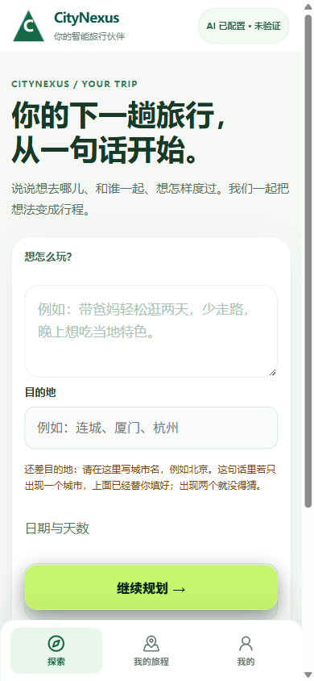
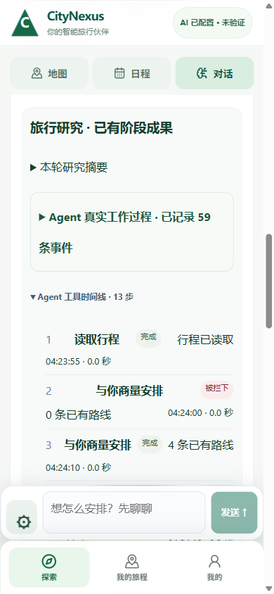
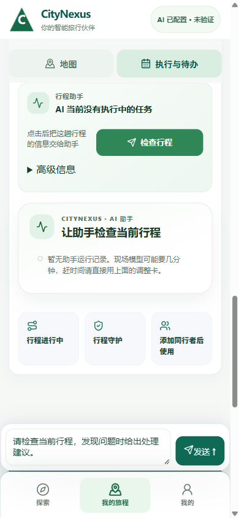
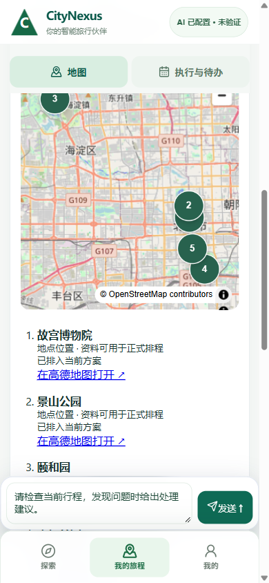
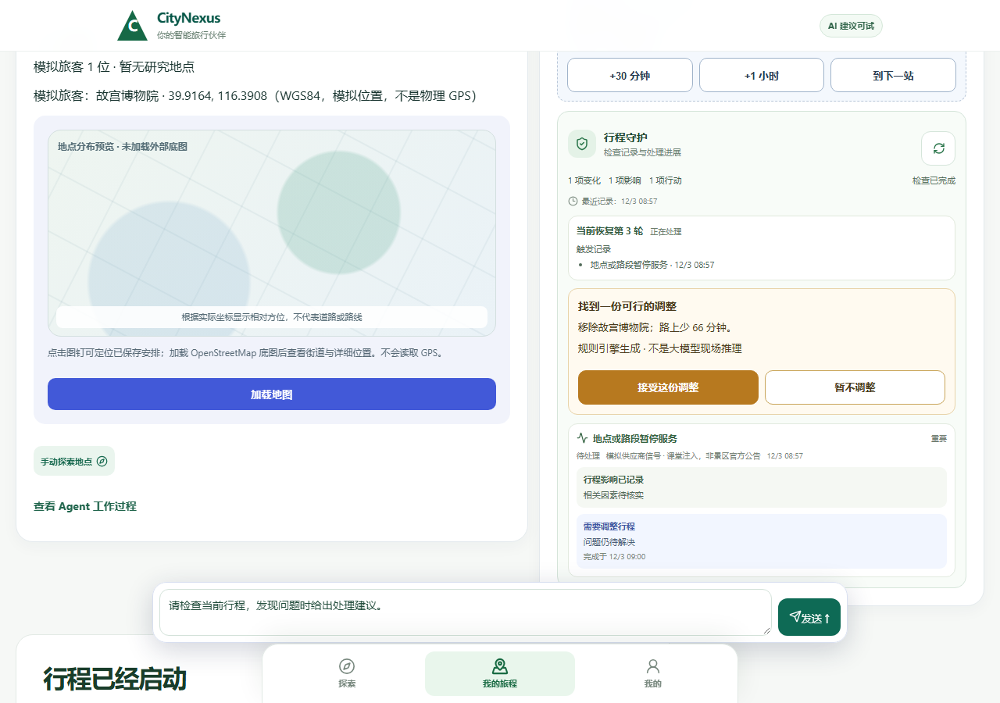
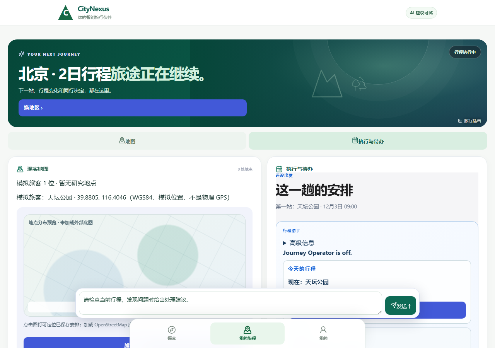

# Revolution V3 and Classroom Showcase

**October 2026 | Human-first redesign | Real captured screens | Simulated two-day journey**

The earlier CityNexus code had a broad feature set, but the normal user often struggled to know where to begin, find the AI Agent, get a real city result or continue after a backend refusal. Meanwhile, a university classroom cannot physically travel for two days during a five-minute presentation.

**Revolution V3 was our effort to solve both problems in the actual application.** The work lives primarily on the [original V3 branch](https://github.com/Canshu-King/CityNexus/tree/rescue/v3-final-departure-20261022) and its [human-use evidence](https://github.com/Canshu-King/CityNexus/tree/rescue/v3-final-departure-20261022/trial/results/20261026_gozero). This independent V3 branch is **newer than the original repository default branch**; it is not implicitly integrated into the public coursework snapshot.

The six images below were copied **without redrawing** from real October V3 development and human-browser recordings. The screenshots are in Chinese because the working interface was being tested with Chinese-speaking travellers. The captions translate their function for an English-speaking reviewer.

## A. Traveller-facing V3: from a blank screen to an active trip

| 1. First-person goal entry (390px) | 2. Agent tool activity timeline |
| --- | --- |
|  |  |
| **English explanation:** Tell CityNexus where you want to go, with whom, for how long and what kind of day you prefer. The screen has one primary action: continue planning. | **English explanation:** The conversation displays a source-bound, expandable **Agent tool timeline** with event statuses rather than asking the user to trust a blank spinner or invented inner thoughts. The capture displays historical run activity; it is not a new live model invocation. |

| 3. Journey execution screen | 4. Map and planned place identities |
| --- | --- |
|  |  |
| **English explanation:** The journey enters execution and exposes next actions, the trip assistant, and the Agent's current availability. The screenshot itself says the AI has no active task; **that is not hidden**. | **English explanation:** Map tiles and place markers are visible for a planned city trip. Distinct Place identities and coordinate systems were inspected in testing. The marker on a map is **not a GPS-proven person**. |

**What the browser evidence reported:** On Oct 27, a normal Chrome click sequence at mobile widths **390×844** and **430×932** moved from entering a natural-language goal to a signed Journey, candidate-plan preparation/approval and an **ACTIVE** result in local test conditions. The result notes include remaining failure gates and a later branch-generation consistency check. [Read the complete October V3 delivery receipt](https://github.com/Canshu-King/CityNexus/blob/rescue/v3-final-departure-20261022/trial/results/20261027_GO_FROM_BLANK_DELIVERY.md). This is an engineering result, **not certification for every phone or remote deployment**.

## B. The classroom simulation: make a two-day trip observable in minutes

| 5. Presenter controls and a proposed change | 6. After accepting the controlled change |
| --- | --- |
|  |  |
| **English explanation:** A classroom presenter can advance simulated time, jump to the next stop or introduce a labelled event. In this capture, a proposed change would remove a stop and reduce travel time; the presenter must explicitly accept or reject it. | **English explanation:** After the proposed adjustment is accepted, the displayed trip and route intention reflect the new approved plan. The on-screen position is expressly **simulated**, not a device GPS claim. |

### What the Presenter did, technically

- A launcher prepared an isolated demo stack and a short-lived pairing link for the same local network.
- The server persisted a **SimulationRun** with a virtual clock, virtual location, activity transitions, event state and a user-facing control panel.
- Classroom controls included **+30 minutes**, **+1 hour**, **next stop**, and optional **closed venue / rain / schedule delay** scenarios.
- Guardian and the Agent were distinct from deterministic/demo alternatives; a prepared suggestion should never be presented as spontaneous live AI reasoning.
- The team prepared an operator quick card, tested local browser states and recorded explicit known failure cases (expired pairing, provider unavailability, slow external Agent and missing map tiles).

**Primary sources:** [Classroom quick card](https://github.com/Canshu-King/CityNexus/blob/rescue/v3-final-departure-20261022/trial/results/20261025_CLASSROOM_QUICK_CARD.md) · [Classroom runbook](https://github.com/Canshu-King/CityNexus/blob/rescue/v3-final-departure-20261022/trial/results/20261025_CLASSROOM_DEMO_RUNBOOK.md) · [Simulation code](https://github.com/Canshu-King/CityNexus/tree/rescue/v3-final-departure-20261022/trial/play_launcher/classroom_demo).

### A concrete local result: four Suzhou stops in one simulated run

The [Oct 26 Suzhou experiment report](https://github.com/Canshu-King/CityNexus/blob/rescue/v3-final-departure-20261022/trial/results/20261026_SUZHOU_FOUR_STOP_LIVE_CHAIN.md) binds a single Journey, SimulationRun, event, external AgentRun, accepted proposal and final simulation progress. It records four distinct city places across two **virtual** dates:

- Day 1: **Humble Administrator's Garden** and **Suzhou Museum**.
- Day 2: **Suzhou Garden Museum** and **Pingjiang Road**.

The run acquired source-bound walking-route facts; one external Guardian/Agent invocation occurred and was reported as **PARTIAL** with persisted tool errors; a user-authenticated proposal was accepted; the Journey reached **SIMULATED_COMPLETED** and remained persisted on restart. The four activity completions were simulated; this was **not** a person physically visiting four places or driving the app for two calendar days.

**Why this matters:** The user-facing problem was not just "does the backend pass tests?" It was "can a professor see a long-running journey change during a short classroom session?" This experiment moves closer to a tangible answer while preserving honest reality-vs-simulation labels.

## C. Interactive design research and revision

The V3 design work included ten individually named user-journey screens covering exploration, Agent research, map, place details, three-plan comparison, daily itinerary, departure, live travel, Guardian recovery and group decisions. These are **design reference images** and are not proof that the full V3 stack currently reproduces each one.

[Explore the original ten-screen V3 design reference directory](https://github.com/Canshu-King/CityNexus/tree/rescue/v3-final-departure-20261022/docs/revolution/v3-design).

This is distinct from the six actual development/test screenshots above. A designed mockup should never be shown as a live product screenshot.

## D. What remained unfinished by the Oct 29 handoff

The [latest handoff](https://github.com/Canshu-King/CityNexus/blob/rescue/v3-final-departure-20261022/trial/results/20261029_HANDOFF_GO_FROM_BLANK_r185.md) and [Oct 27 delivery note](https://github.com/Canshu-King/CityNexus/blob/rescue/v3-final-departure-20261022/trial/results/20261027_GO_FROM_BLANK_DELIVERY.md) include important limitations: some session-return/re-authentication experiences, source/price-unknown semantics, residual test failures and application-version parity were still under examination. Most importantly, **the owner's physical tablet USER_VERIFIED state was PENDING**.

So this work demonstrates a meaningful implemented interface, executable controlled flows and a classroom simulation approach. It does **not** justify saying that the complete AI-driven product was flawlessly demonstrated to the professor, or that all simulated/frozen/provider facts were live at the same time.

## What to read next

- [The entire project in one narrative](PROJECT_PORTAL.md).
- [Feature-by-feature source map](FEATURE_ATLAS.md).
- [Revolution Lab case studies](EXPERIMENT_RESULTS.md).
- [Editable original diagrams, Gantt and Project plan](../teacher-materials/README.md).
- [All five public repositories and branch map](DEVELOPMENT_STREAMS.md).
