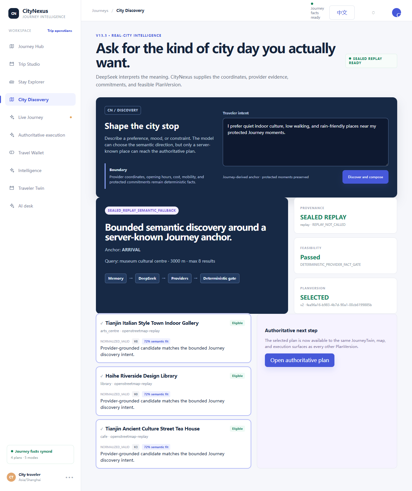
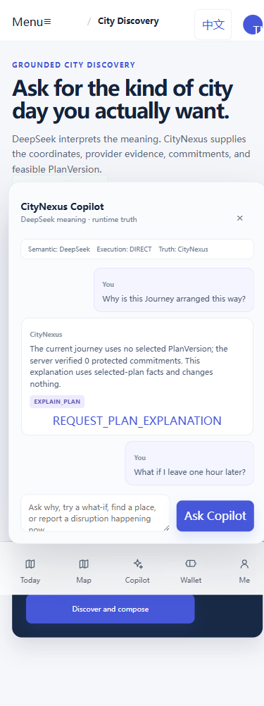
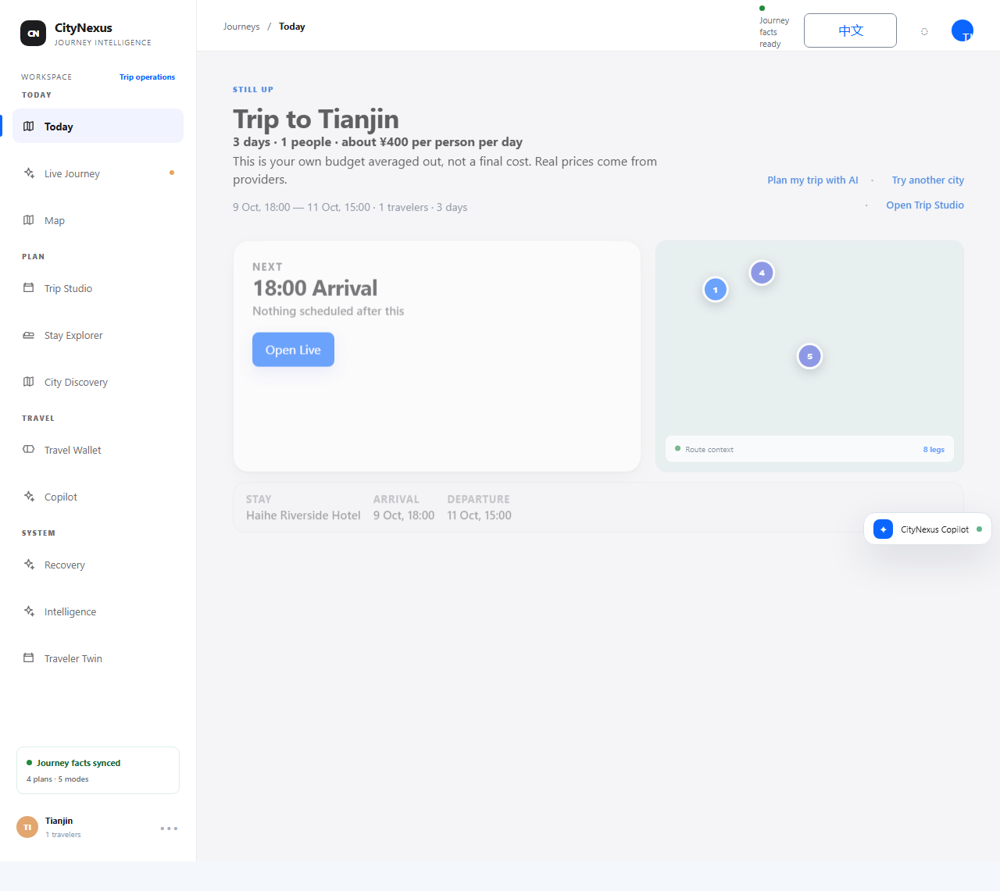
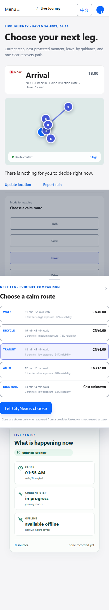
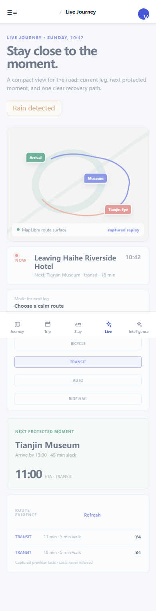
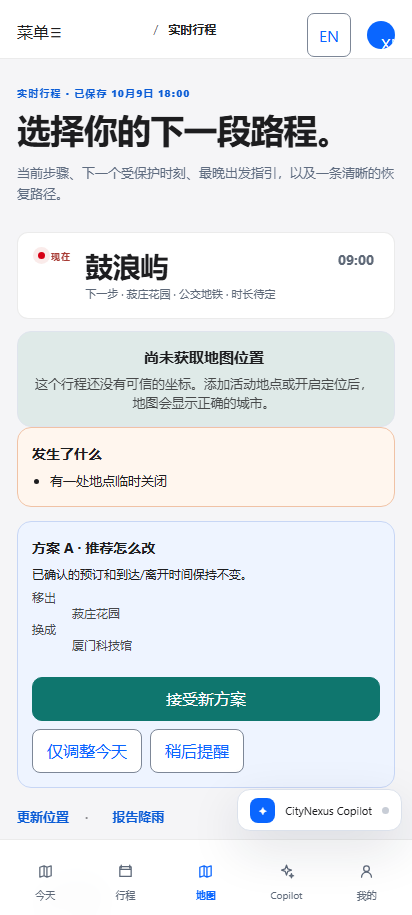
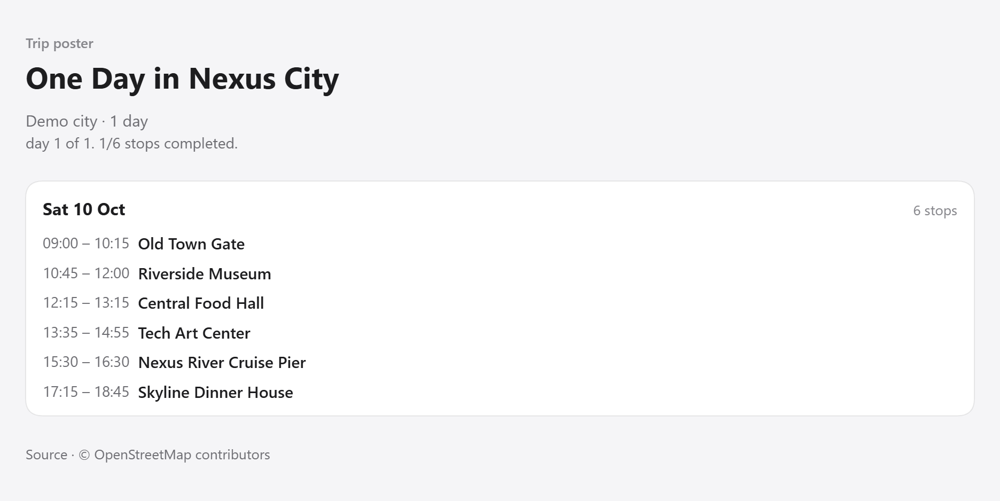
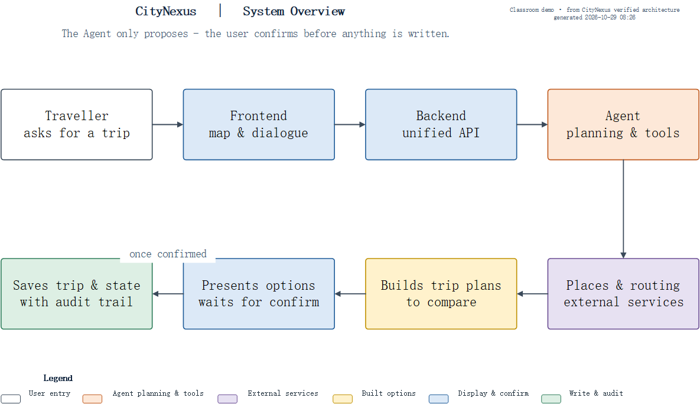
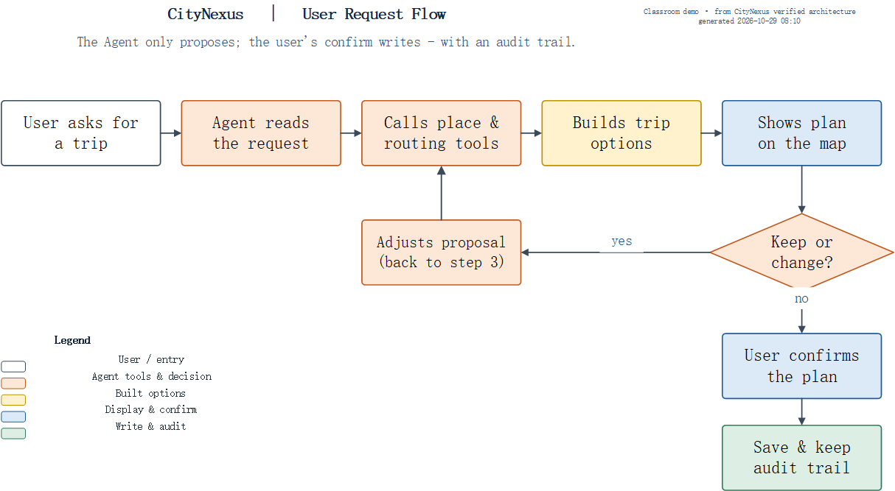
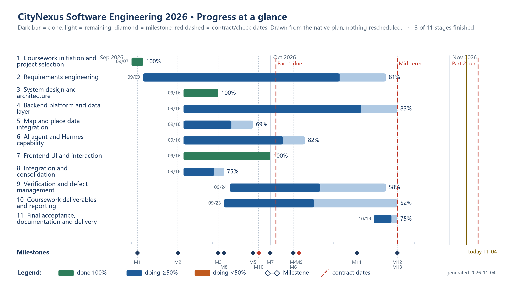

# Visual Gallery: Actual CityNexus Development Captures

These are **real screenshots captured from the project's development and test interfaces** and historical classroom assets. They were copied from the original development snapshots (now in the publicly accessible CityNexus repository) without redrawing them. Some scenes use recorded/replayed/demo data; they **do not** imply a currently deployed production app or successful real-world travel.

**The project also has a later October human-first V3 interface and a separate classroom time/location simulator.** Start with [the V3 six-image walkthrough](CLASSROOM_AND_V3.md) for newer goal entry, Agent tool timeline, actual map, ACTIVE journey and Presenter captures. The gallery below preserves the earlier UI stream and engineering diagrams.

## 1. City discovery and conversational Agent

| City discovery, desktop | Copilot interaction, mobile |
| --- | --- |
|  |  |

**What this demonstrates:** The frontend includes an input for the traveller's intent, candidate places, feasibility/provenance indicators and an Agent conversation surface. The city discovery screenshot explicitly states **SEALED REPLAY**, meaning a controlled capture, not a new live discovery run.

**Source:** [Discovery UI](../frontend/src/features/discovery/RealCityDiscoveryPanel.tsx), [Agent dialogue](../frontend/src/features/agent/AgentComposer.tsx) and [backend provider adapters](../backend/app/integrations/discovery/).

## 2. Journey overview, navigation and mobility choices

| Journey home, desktop | Mobile next-leg comparison |
| --- | --- |
|  |  |

These show the **structure and interface** for a journey dashboard and transport comparison. The mobile screenshot uses stored or captured data and illustrates explicit costs and evidence labels; it is not a current journey tracking session.

**Source:** [Journey shell](../frontend/src/app/V8Experience.tsx), [mobility choices](../frontend/src/features/mobility/MobilitySheet.tsx), [mobility integration](../backend/app/integrations/mobility/).

## 3. During a trip: progress and recovery

| Mobile live-journey capture | Recovery proposal view (Chinese UI) |
| --- | --- |
|  |  |

These show that the project's screen work extends beyond the initial itinerary into in-journey status, decision points and proposed replanning. The recovery screenshot is in Chinese, reflecting bilingual UI development. This is a **test-state capture**, not a claim that a real provider disruption occurred at this exact screenshot.

**Source:** [Live execution](../frontend/src/features/execution/V10LiveExecutionPanel.tsx), [Recovery screen](../frontend/src/features/recovery/RecoveryRequiredPanel.tsx), [Replanning backend](../backend/app/replanning/).

## 4. Product export / sharing

The project also explored itinerary sharing and trip-poster export. This image is a **demo-city sample**, not real travel proof.

**Source:** [Poster UI](../frontend/src/features/poster/TripPosterPanel.tsx), [Shared poster](../frontend/src/features/poster/SharedPosterScreen.tsx).

## 5. Software Engineering diagrams and planning

### System architecture

### Agent and user-confirmation workflow

### Gantt plan snapshot

This Gantt image is a **historical 4 November planning/status capture**, not today's automatically calculated final completion percentage. The editable `.vsdx` / `.mpp` and readable PDF originals remain available in [teacher materials](../teacher-materials/README.md).

## What a screenshot proves and does not prove

A screenshot is evidence that **a concrete UI was rendered in a particular development or controlled-test state**. It is not evidence that every button completes a real API-driven journey, that external AI is currently connected or that a trip was physically taken. For actual observed API and test outcomes, see [ten research cases](EXPERIMENT_RESULTS.md).

**Full source provenance for all screenshots:** [Screenshots index](../screenshots/README.md).